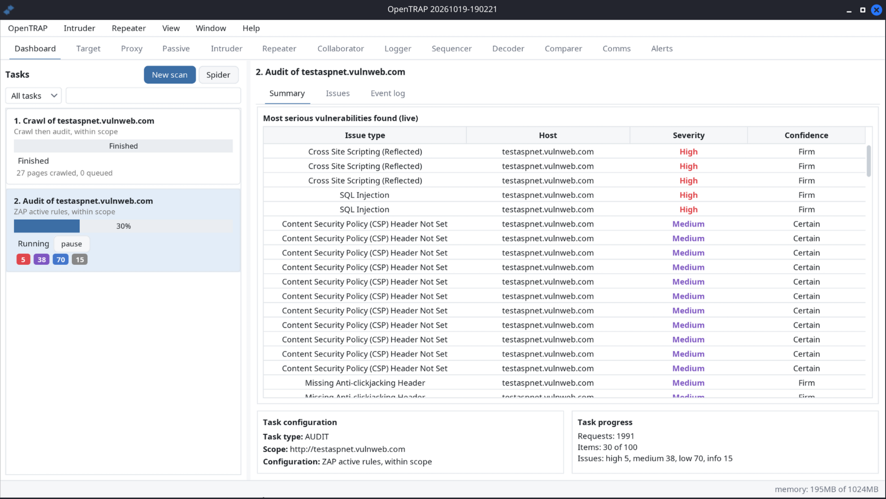
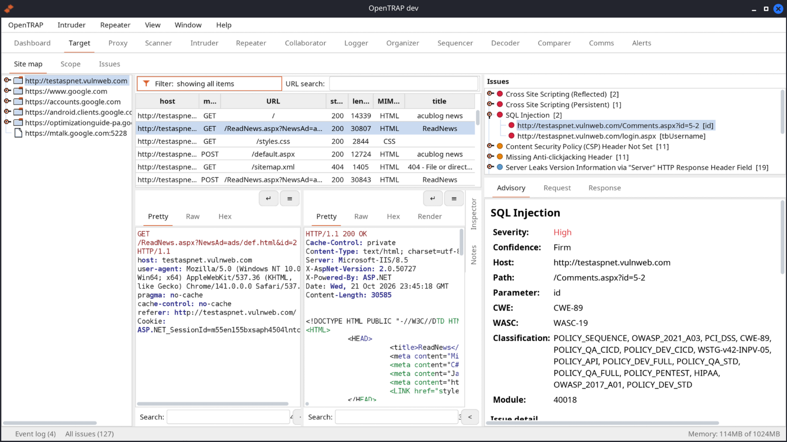
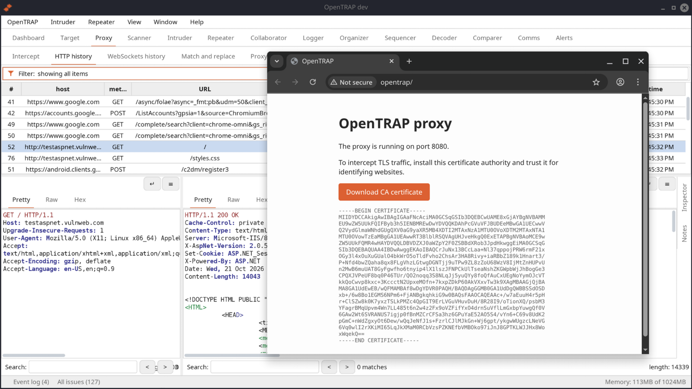
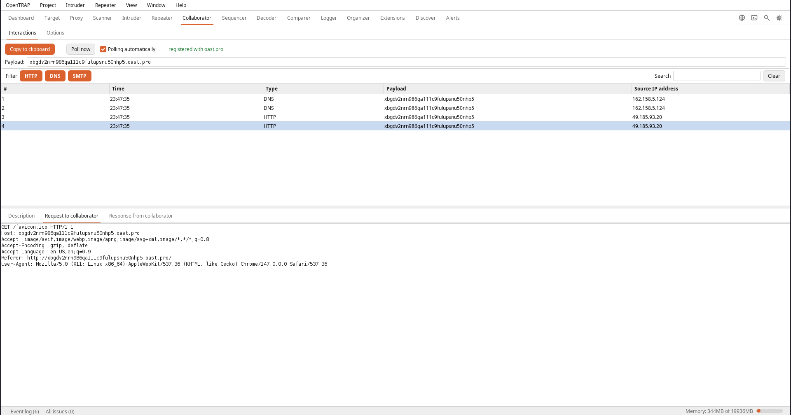
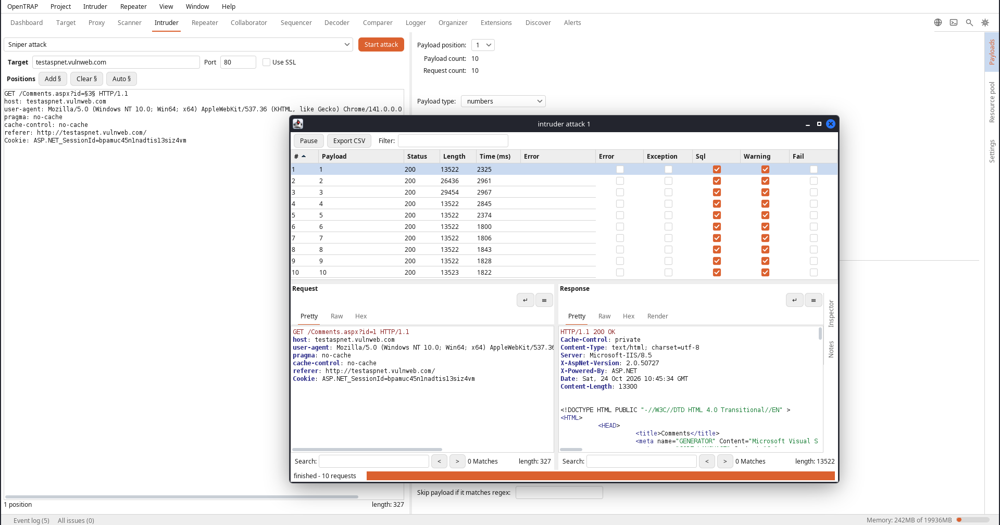
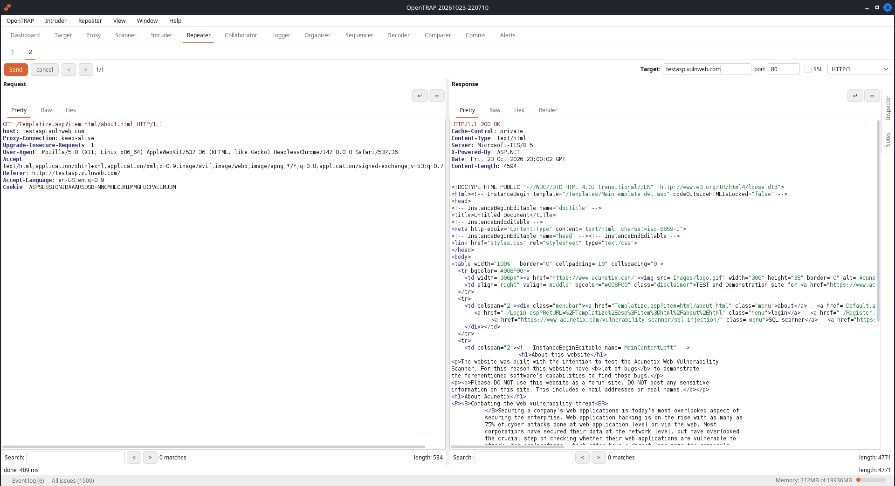
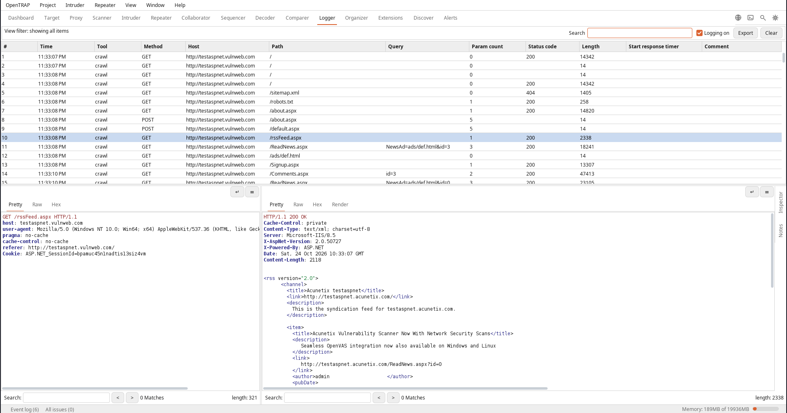
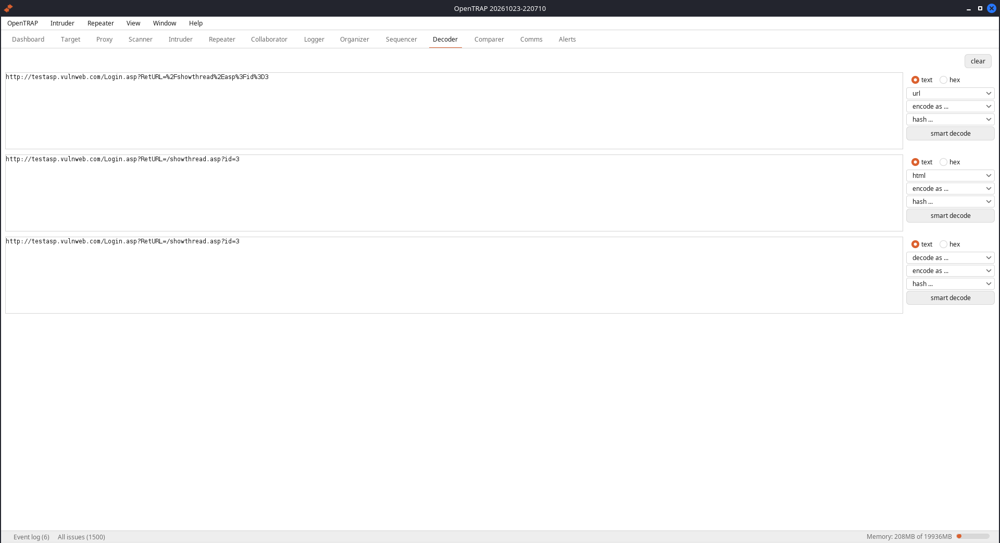
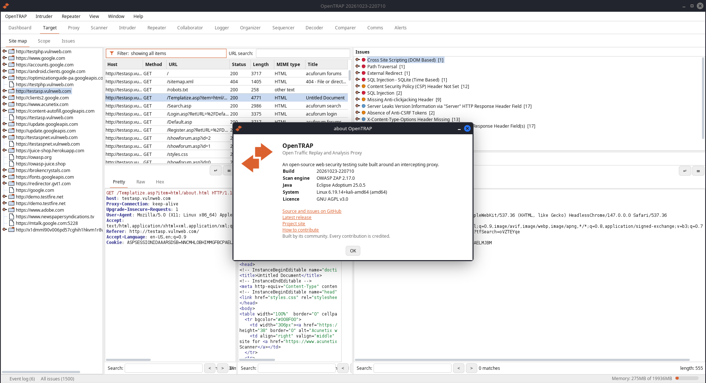

# OpenTRAP

**Open Traffic Replay and Analysis Proxy** - a free, open-source alternative to Burp
Suite: a community-driven web security testing suite built around an intercepting HTTP
proxy, powered by the OWASP ZAP engine.

Capture, inspect, replay and tamper with the traffic between a browser and a web
application, map an application's attack surface, crawl and audit it for real
vulnerabilities, and drive repeatable manual and automated testing from one
workspace, all with a familiar, recognisable workflow.

<a href="images/dashboard.png"></a>

*A live audit on the Dashboard: crawl complete, active scan running, high-severity findings arriving as they are confirmed.*

<a class="github-button" href="https://github.com/opentrap/opentrap" data-color-scheme="no-preference: light; light: light; dark: dark;" data-icon="octicon-star" data-size="large" data-show-count="true" aria-label="Star opentrap/opentrap on GitHub">Star</a>
<script async defer src="https://buttons.github.io/buttons.js"></script>

**[Download the latest AppImage for Linux](https://github.com/opentrap/opentrap/releases/latest/download/opentrap-x86_64.appimage)** (one file, nothing to install), then see [Get started](#get-started) below. All releases are on the [releases page](https://github.com/opentrap/opentrap/releases/latest).

## Why OpenTRAP

- **A proxy-first testing suite.** Intercept, HTTP history, repeater, intruder,
  sequencer, decoder, comparer, an out-of-band collaborator, and a complete
  traffic logger, all in one window.
- **Scanning that holds up.** Crawl and audit for real vulnerabilities, with
  findings in a clear issue view and the evidence highlighted, built on a proven,
  industry-grade engine.
- **One self-contained file.** Every release is a single Linux AppImage with its
  own runtime and the scan engine built in. Download it, run it, scan.
- **Genuinely open.** Licensed under the GNU AGPL v3.0, so it stays open and
  hackable, with no licence gate on its core capabilities.

## See it in action

Every tool lives in one window. Click any screenshot for the full-size image.

<a href="images/target.png"></a>

**Target**<br>The site map and scope on the left, every request in the middle, and every issue found on the right. Select a finding and the advisory, request and response are beside it, with severity, confidence, parameter and CWE ready to hand to a developer.

<a href="images/proxy.png"></a>

**Proxy and built-in browser**<br>Click *open browser* on the Proxy tab and a bundled Chromium starts in an isolated profile, already routed through the proxy and already trusting OpenTRAP's certificate authority. TLS interception works with nothing to configure and no certificate to install.

<a href="images/collaborator.png"></a>

**Collaborator**<br>Generate a payload, put it in a request, and watch the out-of-band DNS and HTTP interactions arrive. Every callback is recorded with its source and full request, so blind vulnerabilities can be proven, not guessed at.

<a href="images/intruder.png"></a>

**Intruder**<br>Mark the positions, choose one of four attack types, and drive a payload set through them. The live attack table shows status, length and timing for every request, so an interesting response stands out at a glance.

<a href="images/repeater.png"></a>

**Repeater**<br>Edit a request and reissue it, one numbered tab at a time, with the full response beside it. The quickest way to probe a single endpoint by hand and watch exactly how it answers.

<a href="images/logger.png"></a>

**Logger**<br>A complete record of every request OpenTRAP and the scan engine make, tagged by the tool that sent it, with the request and response viewers below. Nothing happens behind your back.

<a href="images/decoder.png"></a>

**Decoder**<br>Paste a value and build a pipeline of URL, Base64, hex and hash transforms, in either direction, or let smart decode work out the encoding for you. The quickest way to read or craft an encoded parameter.

<a href="images/about.png"></a>

**About**<br>The build, the scan engine in use and where it comes from, the runtime and the licence, stated plainly. OpenTRAP is open about what is inside it.

## Get started

Download the latest release from the [releases page](https://github.com/opentrap/opentrap/releases/latest) and run it. Nothing to install.

**One file: the AppImage** - it bundles its own Java runtime and the scan engine,
so there is no Java to install. This link always points at the latest release:
[opentrap-x86_64.appimage](https://github.com/opentrap/opentrap/releases/latest/download/opentrap-x86_64.appimage)

Or from a terminal, fetch it:

```
wget https://github.com/opentrap/opentrap/releases/latest/download/opentrap-x86_64.appimage
```

make it executable:

```
chmod +x opentrap-x86_64.appimage
```

and run it:

```
./opentrap-x86_64.appimage
```

You can also double-click the downloaded file in your file manager.

The download is complete: the Java runtime and the scan engine are inside the
file and set themselves up on first use. Every release is this one AppImage, so
nothing ships with parts missing. The optional testing browser is an in-app
download when you want it.

## FAQ

**Is there a free, open-source alternative to Burp Suite?** Yes. OpenTRAP offers the intercepting-proxy workflow Burp users know, with Proxy, Repeater, Intruder, Collaborator, Sequencer, Decoder and Comparer, under the AGPL-3.0 with no paid tier.

**How does OpenTRAP relate to OWASP ZAP?** It uses the OWASP ZAP engine for crawling and scanning and puts a familiar, Burp-style interface on top: ZAP's detection in a proxy-first workspace.

**Which platforms does it run on?** A single self-contained Linux AppImage today, with the Java runtime and the scan engine inside the file.

**Is it really free?** Yes, released under the GNU AGPL v3.0, with every capability open and nothing reserved for a paid edition.

## Learn more

- [Source, README and documentation](https://github.com/opentrap/opentrap)
- [How to contribute](https://github.com/opentrap/opentrap/blob/main/CONTRIBUTING.md)
- [Licence: GNU AGPL v3.0](https://www.gnu.org/licenses/agpl-3.0.html)

*OpenTRAP is independent open-source software, released under the GNU AGPL v3.0.
See the repository for full credits and component licences.*
