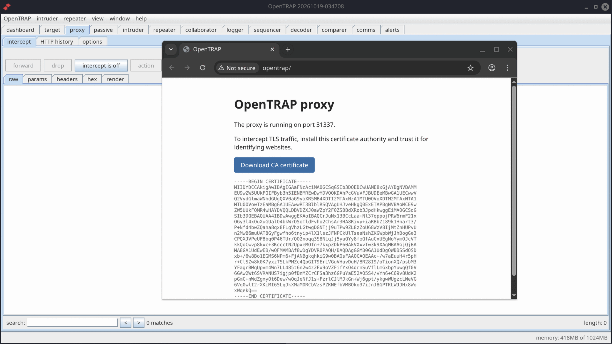
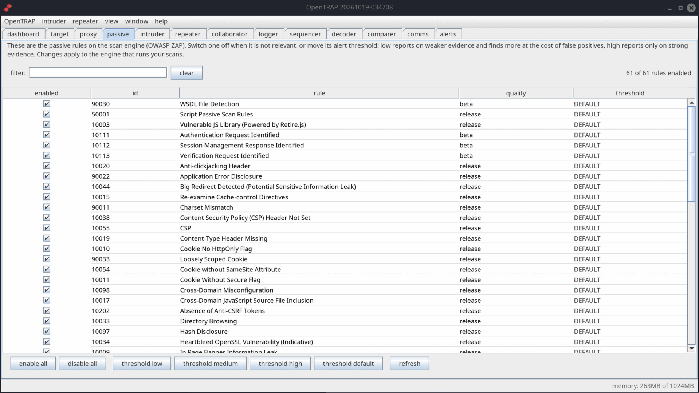

# OpenTRAP

**Open Traffic Replay and Analysis Proxy** - an open-source, community-driven web
security testing suite built around an intercepting HTTP proxy.

Capture, inspect, replay and tamper with the traffic between a browser and a web
application, map an application's attack surface, crawl and audit it for real
vulnerabilities, and drive repeatable manual and automated testing from one
workspace, all with a familiar, recognisable workflow.

<a href="images/dashboard.png"></a>

*A live audit on the Dashboard: crawl complete, active scan running, high-severity findings arriving as they are confirmed.*

**[Download the latest release](https://github.com/opentrap/opentrap/releases/latest)** for Linux, then see [Get started](#get-started) below.

## Why OpenTRAP

- **A proxy-first testing suite.** Intercept, HTTP history, repeater, intruder,
  sequencer, decoder, comparer, an out-of-band collaborator, and a complete
  traffic logger, all in one window.
- **Scanning that holds up.** Crawl and audit for real vulnerabilities, with
  findings in a clear issue view and the evidence highlighted, built on a proven,
  industry-grade engine.
- **One self-contained file.** The release is a single Linux jar with the scan
  engine built in. Download it, run it, scan, there is nothing else to install.
- **Looks right on any screen.** The interface detects your display and scales
  itself, crisp on a 4K panel, normal on 1080p.
- **Genuinely open.** Licensed under the GNU AGPL v3.0, so it stays open and
  hackable, with no licence gate on its core capabilities.

## See it in action

Every tool lives in one window. Click any screenshot for the full-size image.

<a href="images/target.png"></a>

**Target.** The site map and scope on the left, every request in the middle, and every issue found on the right. Select a finding and the advisory, request and response are beside it, with severity, confidence, parameter and CWE ready to hand to a developer.

<a href="images/browser.png"></a>

**Built-in browser.** Click *open browser* on the Proxy tab and a bundled Chromium starts in an isolated profile, already routed through the proxy and already trusting OpenTRAP's certificate authority. TLS interception works with nothing to configure and no certificate to install.

<a href="images/collaborator.png"></a>

**Collaborator.** Generate a payload, put it in a request, and watch the out-of-band DNS and HTTP interactions arrive. Every callback is recorded with its source and full request, so blind vulnerabilities can be proven, not guessed at.

<a href="images/passive.png"></a>

**Passive rules.** Every detection rule in the engine in one filterable list. Switch rules on or off, move the alert threshold per rule, and add your own detection rules, with changes applied to the engine that runs your scans.

<a href="images/logger.png"></a>

**Logger.** A complete record of every request OpenTRAP and the scan engine make, tagged by the tool that sent it, with the request and response viewers below. Nothing happens behind your back.

## Get started

Download the latest release from the [releases page](https://github.com/opentrap/opentrap/releases/latest) and run it. Nothing to install.

**Recommended: the AppImage** - one self-contained file, no Java needed:

```
chmod +x opentrap-x86_64.appimage
./opentrap-x86_64.appimage
```

Or double-click it in your file manager.

**Or the jar**, if you already have Java 17 or newer:

```
java -jar opentrap_<timestamp>.jar
```

The scan engine is built in and sets itself up on first run; the optional testing
browser is an in-app download when you want it.

## Learn more

- [Source, README and documentation](https://github.com/opentrap/opentrap)
- [How to contribute](https://github.com/opentrap/opentrap/blob/main/CONTRIBUTING.md)
- [Licence: GNU AGPL v3.0](https://www.gnu.org/licenses/agpl-3.0.html)

*OpenTRAP is independent open-source software, released under the GNU AGPL v3.0.
See the repository for full credits and component licences.*
